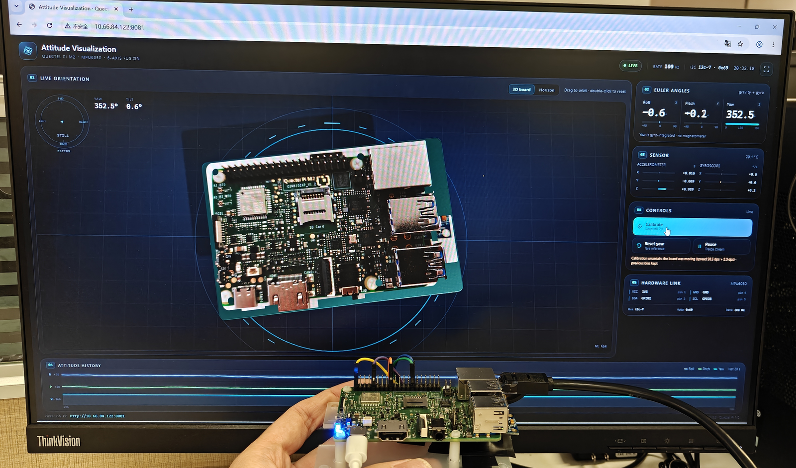

# 📡 IMU 可视化 Demo - IMU Visualization

[English](README.md) | 中文

本项目基于 [Quectel Pi M2 智能主控板](https://www.quectel.com.cn/product/quectel-pi-m2) 开发。MPU6050 通过 40-pin 排针的 I2C7 接入（本板枚举为 `/dev/i2c-7`），板端默认以 100 Hz 采样并做六轴姿态融合，浏览器实时渲染 3D 板卡、人工地平仪和角度曲线。用户手持板卡倾斜或旋转时，触摸屏和同一局域网内的电脑浏览器都能同步看到姿态变化。界面提供陀螺零偏校准、偏航清零、暂停和全屏模式，所有读数均来自实际 MPU6050。



▶ **[观看演示视频](assets/demo_imu_visualization.mp4)**（约 48 秒）

## 🎯 功能特点

- **实时 3D 姿态**：默认俯视图；M2 板按融合四元数旋转，支持触摸或鼠标拖动环绕，双击恢复默认俯视
- **相对平移箭头**：有效推力（水平加速度高于 0.7 m/s² 且持续至少 80 ms）会捕获移动方向，左上角 MOTION 指示器显示满格橙色箭头约 0.7 秒；手停住时的反向减速会被忽略，箭头不会反跳，轻微碰动和轻点会被过滤；这是相对运动提示，不是绝对定位
- **实物板卡贴图**：M2 顶面和底面使用开发板实物照片，旋转时仍能看清 40-pin 排针、网口、USB、SD 卡和丝印
- **人工地平仪**：独立的全屏姿态仪，包含俯仰梯度、滚转刻度和偏航带，适合在触摸屏上快速判读
- **三轴读数与曲线**：显示滚转、俯仰、偏航、三轴加速度、三轴角速度和温度，底部保留 20 秒历史曲线
- **零偏校准**：静止保持约 2 秒即可测量三轴陀螺零偏；检测到晃动时保留旧零偏，并在界面上说明原因
- **偏航清零**：把当前朝向设为 0°，不改变滚转和俯仰；偏航由陀螺积分得到（`000–360°` 罗盘航向，顺时针增大），界面明确标注没有磁力计
- **双屏访问**：板端触摸屏用 Chromium kiosk 打开，电脑通过局域网地址访问；1024×600 和 1440×900 布局均已适配
- **零运行依赖与自动恢复**：Web 服务、I2C 传输和融合算法全部使用 Python 标准库；传感器掉线后自动重连，状态实时显示在页面上

## 📋 系统要求

### 硬件要求

- Quectel Pi M2 智能主控板（Debian 13 出厂镜像，40-pin 排针）
- MPU6050 传感器模块（GY-521 等常见模块，3.3 V 供电）
- 杜邦线 4 根：VCC、GND、SDA、SCL
- 触摸屏或 HDMI 显示器；可选 USB 键盘、鼠标
- 可选的局域网连接，用于从电脑浏览器观看

| MPU6050 引脚 | M2 40-pin | 说明 |
| --- | --- | --- |
| VCC | 3V3（pin 1） | 必须接 3.3 V，不要接 5 V |
| GND | GND（pin 6） | 与主控板共地 |
| SDA | GPIO2 / SDA（pin 3） | I2C7 数据线 |
| SCL | GPIO3 / SCL（pin 5） | I2C7 时钟线 |
| AD0 | 悬空 | 地址为 `0x68`；接 3V3 时为 `0x69` |
| INT | 不接 | 程序使用轮询读取，不依赖中断 |

40-pin 排针的 I2C 在本板枚举为 `/dev/i2c-7`。程序启动时会自动扫描 `/dev/i2c-*` 和 `0x68/0x69`，接在其他总线或使用 `0x69` 时无需改配置；本板当前在 `/dev/i2c-7`、地址 `0x69`（AD0 接高）上自动选中 MPU6050。

### 软件要求

- 操作系统：Debian 13（Quectel Pi M2 出厂镜像，无需重新烧录）
- Python 3.9 或更高版本；`venv` 可选，项目没有第三方运行依赖
- 设备节点：本板为 `/dev/i2c-7`（程序会自动扫描任意 `/dev/i2c-N`）
- 网络端口：`8081/tcp`（可用 `--port` 修改）
- 浏览器：Chromium 或 Google Chrome；3D 视图需要 WebGL，地平仪视图不依赖 WebGL
- 当前用户需要属于 `i2c` 组，安装脚本会检查并提示

## 🚀 安装与运行

1. 在主控板上安装 git，并把仓库克隆到 `~/projects/`：

```bash
sudo apt update
sudo apt install -y git
cd ~/projects
git clone https://github.com/Quectel-Pi/demo-imu-visualization.git
```

2. 进入工程目录并运行部署脚本。脚本是幂等的：创建或复用 `.venv`、检查依赖、补执行位并探测 I2C 设备：

```bash
cd ~/projects/demo-imu-visualization
./install.sh
```

3. 做一次只读自检，确认 Python 模块、I2C 总线、MPU6050 地址和访问地址都正常：

```bash
./scripts/preflight.sh
```

如果输出包含 `found MPU6050 on /dev/i2c-7 at 0x69 (WHO_AM_I 0x68)`，说明接线和权限正常。

4. 启动程序。程序会打印本机所有可访问地址，电脑浏览器打开其中任意一个即可：

```bash
./run.sh
```

启动后能看到类似下面的输出：

```text
Open from :
  http://192.168.1.50:8081/  (eth0)
```

板子 IP 会随网络变化，以终端打印为准。忘记地址时可以在板端执行 `~/imu-url`（`install.sh` 会创建这个快捷命令），或再次查看网络接口地址。需要换端口时使用：

```bash
./run.sh --port 8090
```

默认端口是 `8081`。需要固定使用其他端口时，在服务文件 `ExecStart` 末尾加 `--port <端口>`。

### 配置开机自启动（可选）

把工程自带的服务文件复制到 systemd，然后启用：

```bash
sudo cp scripts/demo-imu-visualization.service /etc/systemd/system/
sudo systemctl daemon-reload
sudo systemctl enable --now demo-imu-visualization
```

服务文件默认按 `~/projects/demo-imu-visualization` 部署；如果板端账号或路径不同，先修改服务文件中的 `User` 和 `WorkingDirectory` 再复制。需要触摸屏自动进入全屏页面时，可安装 Chromium 后执行：

```bash
./scripts/start_kiosk.sh
```

## 🎛️ 使用说明

页面左侧是 3D 板卡或人工地平仪舞台，右侧是欧拉角、传感器、控制按钮和硬件信息，底部是 20 秒姿态曲线。所有界面文案和状态提示均为英文，方便在触摸屏和电脑上共用同一套页面。

- **观察姿态**：默认是俯视图；手持板卡缓慢倾斜或旋转，3D 板卡会跟随融合后的姿态实时转动。平移板卡时，板卡保持居中，左上角 MOTION 指示器出现指向移动方向的橙色箭头；拖动画面可以环绕观察，双击恢复默认俯视
- **切换视图**：顶部 `3D board` 与 `Horizon` 按钮切换两种主视图；地平仪视图包含俯仰梯度、滚转刻度和偏航带
- **陀螺校准**：把板卡平放并保持不动，点击 `Calibrate`；校准约 2 秒，期间界面会显示 Calibrating。若检测到晃动，程序不会应用这次测量结果
- **偏航清零**：点击 `Reset yaw` 把当前朝向设为 0°；滚转和俯仰保持真实重力参考。没有磁力计时偏航会随时间缓慢漂移（显示为 `000–360°` 罗盘航向，顺时针增大），可随时清零
- **暂停与全屏**：`Pause` 冻结数据流，方便观察某一姿态；右上角全屏按钮或键盘 `F` 进入全屏
- **电脑观看**：在同一局域网内打开板端打印的 `http://<board-ip>:8081/`，页面和触摸屏完全一致
- **首次启动**：程序会自动做一次静止校准，并把当前姿态记为水平参考；如果启动时板卡正在移动，页面会提示校准不确定，放平稳后手动点击 `Calibrate` 即可
- **安装方向**：启动校准同时会记录传感器安装方向并归一化 1 g 加速度，倒装或倾斜安装的模块也能直接显示成正向水平
- **3D 模型说明**：画面中的 M2 板使用开发板上/下视照片贴图；MPU6050 为外接传感器，不在 3D 画面中额外绘制模块和杜邦线；角度和相对平移来自 MPU6050，平移以箭头显示，是相对运动提示，不是机械尺寸图或绝对定位

### 协议要点

- **总线与地址**：I2C；本板 40-pin 排针总线为 `/dev/i2c-7`；7 位地址 `0x68`，`AD0` 接高时为 `0x69`
- **读取方式**：从 `0x3B` 起一次突发读取 14 字节，依次为三轴加速度、温度和三轴角速度，使用 i2c-dev ioctl，不依赖 smbus
- **量程与带宽**：默认陀螺 ±500 °/s、加速度 ±2 g、DLPF 44 Hz、采样 100 Hz
- **姿态融合**：六轴 Madgwick 互补滤波；加速度计修正滚转/俯仰，陀螺积分提供偏航，无磁力计
- **偏航显示**：以 `000–360°` 罗盘航向显示，顺时针旋转增大；欧拉角面板、舞台读数、地平仪偏航带和 20 秒曲线使用同一范围
- **安装参考**：启动静止校准会记录安装旋转和 1 g 比例，把当前姿态设为 0° 参考；`sensor.level_on_start` 设为 `false` 可改为重力绝对方向
- **浏览器链路**：静态页面和 JSON API 由 Python 标准库 HTTP 服务提供；页面约每 33 ms 请求一次 `/api/attitude`，并在本地做四元数插值
- **主要接口**：`/api/attitude`、`/api/status`、`/api/calibrate`、`/api/tare`、`/api/pause`

### 轴序与安装方向

默认认为 GY-521 模块正面朝上、`+X` 指向板卡右侧、`+Y` 指向板卡上方、`+Z` 垂直板面向上。模块如果旋转或翻转安装，可修改 `config.json` 的 `sensor.axis_map`，每个目标轴选择一个源轴，可选负号：

```jsonc
{
  "sensor": {
    "axis_map": {
      "x": "-y",
      "y": "x",
      "z": "z"
    }
  }
}
```

上面的例子表示把模块在板面上顺时针旋转 90° 安装。修改后重启程序，并重新做一次静止校准。`sensor.level_on_start` 默认为 `true`：启动或校准时会把当前静止姿态记为 0° 水平参考，并同时记录安装旋转与 1 g 比例；如果希望显示重力绝对方向而不是启动参考，把它设为 `false`。I2C 地址、量程、采样率和融合增益也都在 `config.json` 中，无需改动源码。

## 📁 项目结构

```text
demo-imu-visualization/
├── src/
│   ├── main.py                    # 启动入口：参数解析、HTTP 服务、退出处理
│   └── attitude/
│       ├── config.py              # 读取 config.json，合并命令行覆盖
│       ├── imu.py                 # MPU6050 i2c-dev 驱动、量程配置、总线探测
│       ├── fusion.py              # 四元数、六轴 Madgwick、零偏与偏航清零
│       ├── service.py             # 采集线程、校准、暂停、状态快照
│       ├── server.py              # 标准库 HTTP 服务与 JSON API
│       └── netinfo.py             # 局域网地址发现
├── web/
│   ├── index.html                 # 单页界面
│   ├── style.css                  # 深色仪表盘样式与响应式布局
│   ├── app.js                     # 轮询、平滑、按钮与状态管理
│   ├── scene3d.js                 # Three.js 板卡场景与环绕相机
│   ├── horizon.js                 # 人工地平仪与偏航带
│   ├── chart.js                   # 20 秒三行姿态曲线
│   ├── assets/m2-board-top.png    # M2 开发板实物上视贴图（UI）
│   ├── assets/m2-board-bottom.png # M2 开发板实物下视贴图（UI）
│   └── vendor/three.min.js        # three.js r140（MIT）
├── scripts/
│   ├── preflight.sh               # 只读自检
│   ├── show_access_url.sh         # 打印局域网访问地址
│   ├── start_kiosk.sh             # Chromium 触摸屏全屏启动
│   └── demo-imu-visualization.service
├── assets/                        # README 配图与演示视频
├── config.json                    # 总线、地址、量程、采样率、轴序
├── install.sh                     # 幂等部署：venv、依赖、权限与探测
├── run.sh                         # 启动脚本，支持 --port
├── requirements.txt               # 无第三方运行依赖
├── README.md                      # 英文说明
├── README_zh.md                   # 中文说明（本文件）
└── THIRD_PARTY_LICENSES.md        # three.js 许可证
```

## 📚 更多文档

- 第三方组件与许可证：见 [THIRD_PARTY_LICENSES.md](THIRD_PARTY_LICENSES.md)
- 板端可以直接运行下面的命令，确认安装、I2C 总线和传感器读取链路：

```bash
PYTHONPATH=src python3 -m attitude.imu --probe
PYTHONPATH=src python3 -m attitude.imu --watch
```

- 本板已在 `/dev/i2c-7`、地址 `0x69` 读到 MPU6050，启动后界面显示 LIVE、速率 100 Hz；如果换线或未接传感器，页面会显示 Sensor lost 并持续重连，不会生成任何模拟读数
- 完整测试代码位于开发工作区的 `test_tools/`，包括融合单元测试、硬件故障服务测试和 HTTP 接口测试，不随工程目录交付

## 📮 报告问题

如果在使用过程中遇到问题，欢迎在 [Quectel Pi 开发专区](https://forumschinese.quectel.com/c/quectel-pi/58) 提交技术咨询，我们的技术支持团队会及时为您解答。欢迎提交 Issue 和 Pull Request 来改进此项目。
